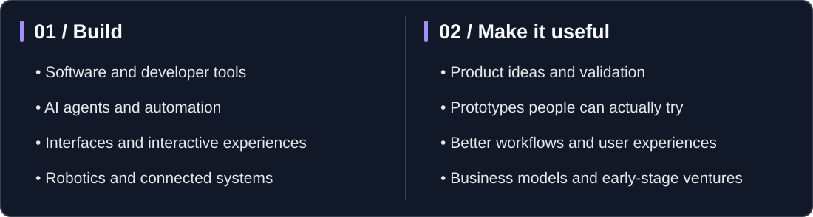

**Software · Experiments · Products · Ventures**

## Hey, I'm Stella.

I like making things. Sometimes useful, sometimes ridiculous, and sometimes just because the idea was too interesting to leave alone.

I work on software, automation, interfaces, and whatever technical rabbit hole seems worth exploring. I also care about the other half of building: **figuring out whether something is actually useful, whether people want it, and how to turn it into a product.**

Not every experiment needs to become a business. But I like knowing which ones *could*.

> **Small clarification:** I'm a guy. Stella Runcandel is the name I use for this experimental, more business-minded side of my work.

## What I'm interested in

I also wander into biology, hardware, and other ambitious ideas. This account is where I give myself room to experiment.

## Tools I reach for

The stack is flexible. The point is to make something that works.

## Projects & experiments

I use this space for prototypes, tools, and early product ideas. Some will be polished; some will be works in progress; some will probably get rebuilt from scratch.

**What to expect:** software experiments, automation, creative tooling, intelligent systems, and the occasional idea that gets a little out of hand.

[**Browse my repositories →**](https://github.com/Stella-Runcandel?tab=repositories)
